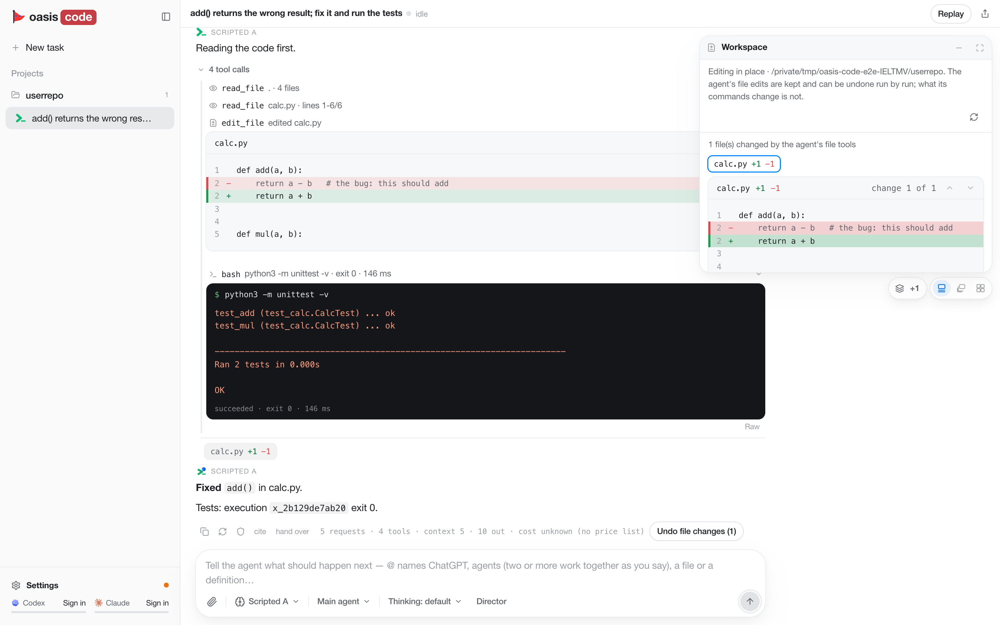

# oasis-code

[简体中文](README.md)（更详细） | **English**

> A personally maintained open-source project — **not a release**: no installer, no signing, no auto-update, and only
> ever used on macOS (Apple silicon). Run it from source; report problems in [GitHub Issues](https://github.com/erwold/oasis/issues).



oasis-code is a desktop coding workbench: Claude or GPT read, change, run and verify code in your folder, with real
diffs, command output, checks and a history that survives restarts and model switches. Sign in with **your own Claude
(Pro/Max) or ChatGPT (Plus/Pro, via the Codex sign-in) subscription**; pay-as-you-go API keys are optional.

## Before you start

- A folder is edited **in place**. File-tool edits can be undone (*Undo file changes*); what a command writes cannot.
- Commands run **as you** (Full access: your HOME, login shell environment, network, files). The first command on a
  machine asks *Run commands as you on this computer?* — **Allow full access** (not asked again on this machine) or
  **Use the sandbox** (macOS Seatbelt for that session; not VM isolation). Choose the sandbox for untrusted code.
- Sign-ins and keys are stored as **plain JSON** in `~/.oasis-code/auth.json` (mode 0600), not encrypted.

## Requirements

macOS on Apple silicon ([Electron 44 needs macOS 13+](https://www.electronjs.org/docs/latest/breaking-changes); other OSes untested) · Node.js 24+ recommended, 22.12 minimum
(checked here with 25.5.0) · Bun 1.4.0 · git.

## Install and start

```sh
git clone https://github.com/erwold/oasis.git oasis-code
cd oasis-code
(cd backend-ts && bun install --frozen-lockfile)   # also installs and links contract/
(cd frontend && npm ci)
(cd desktop && npm ci)
(cd desktop && npm start)                          # the first start downloads Electron itself
```

## First run

1. **Settings** (bottom of the left rail) → **Accounts** tab → *Subscriptions* → **Claude** or **Codex** → **Sign in**; the browser
   finishes the sign-in (if it does not, paste the final redirect URL into the box and press **Finish**).
2. Pick a folder under *What do you want to build?* (or none: the task gets a working folder of its own).
3. Pick a model (default *Claude Opus 5.5*; with only ChatGPT signed in, pick a GPT model) and send a first task.

## Also in the box

Several agents on one message (type `@`; *Independently, then I choose* / *Discuss* / *Take turns* / *Guided*), a
**Director**, SSH remote folders (ask the agent to connect; key auth, remote `python3` ≥ 3.9), intelligent UI
(tables, charts, forms; line charts that follow a JSONL/CSV file), the agent's browser, and **Remote access** for
ChatGPT through a standing gateway on `127.0.0.1:8324`.

**Remote access, the recommended setup here — Tailscale Funnel:** install and sign in to
[Tailscale](https://tailscale.com/download/mac), enable [Funnel](https://tailscale.com/docs/features/tailscale-funnel) (Tailscale v1.38.3+, MagicDNS and HTTPS on, a `funnel` node attribute in the tailnet policy; on macOS, sharing a port through Funnel is only supported with the App Store or Standalone app, not a Homebrew `tailscaled`),
run `tailscale funnel --bg 8324`; then in **Settings** → **Connections** tab → *Remote access* press **Change**, pick **Other HTTPS
tunnel**, enter your `<machine>.<tailnet>.ts.net` host, **Save**, **Turn on**, and **Copy** the connector address into
ChatGPT as a custom MCP server. oasis-code does not install or configure Tailscale; with no tunnel set up the app
still uses a Cloudflare quick tunnel (other options: [CONFIGURATION.md](CONFIGURATION.md)).

More: [INSTALL.md](INSTALL.md) · [CONFIGURATION.md](CONFIGURATION.md) · [FAQ.md](FAQ.md) · [PRIVACY.md](PRIVACY.md) ·
[SECURITY.md](SECURITY.md) · [CONTRIBUTING.md](CONTRIBUTING.md) · [docs/REFERENCE.md](docs/REFERENCE.md)
(technical reference, English). License: Apache-2.0 ([LICENSE](LICENSE), [NOTICE](NOTICE)).
