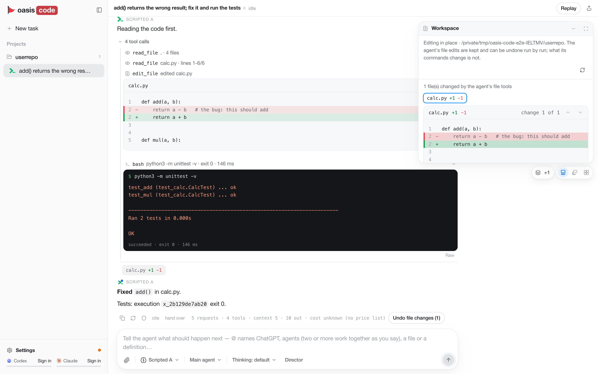

# oasis-code

**简体中文** | [English](README.en.md)

> 这是一个个人维护的开源项目，**不是正式发布版**：没有安装包、没有签名、没有自动更新，
> 也只在 macOS（Apple silicon）上实际用过。请从源码运行，遇到问题请到 [GitHub Issues](https://github.com/erwold/oasis/issues) 反馈。



oasis-code 是一个桌面编码工作台：让 Claude 或 GPT 在你的文件夹里读代码、改代码、跑命令、验证结果，
并把真实的 diff、命令输出、检查结果和对话历史保存下来（重启、换模型后都还在）。模型调用、工具执行、权限、
历史和界面都是这个程序自己实现的，不是套在别的 CLI 外面的壳。

它可以直接用你**自己的 Claude（Pro/Max）或 ChatGPT（Plus/Pro，走 Codex 登录）订阅账号**登录使用；
也可以用按量付费的 API key（可选，不是必须）。

## 先看这几条（安全）

- **默认在原文件夹里直接改**（不复制）。文件工具的写入可以在会话里撤销（*Undo file changes*），
  但命令（`rm`、`git`、构建脚本等）对文件的改动**不能撤销**。重要项目请先提交或备份，或者先拿一份副本试。
- **命令默认以你本人的身份运行**（Full access：你的 HOME、登录 shell 环境、网络和文件）。
  在这台电脑上第一次要跑命令时，会话里会出现问题 *Run commands as you on this computer?*：
  选 **Allow full access** 之后，这台电脑上的后续会话不会再问；选 **Use the sandbox** 则这个会话改在
  macOS Seatbelt 沙箱里跑命令（只能写工作区，读不到凭据目录和本程序的数据）。沙箱不是虚拟机级隔离。
  不信任的仓库请选沙箱。
- 订阅授权和 API key 以**明文 JSON** 保存在本机 `~/.oasis-code/auth.json`（权限 0600），不是加密存储。
- 更多：[PRIVACY.md](PRIVACY.md)（数据会发到哪里）、[SECURITY.md](SECURITY.md)（安全边界与报告问题）。

## 需要准备什么

| 工具 | 版本 | 说明 |
|---|---|---|
| macOS | Apple silicon；Electron 44 本身要求 macOS 13（Ventura）或更新（[Electron 官方说明](https://www.electronjs.org/docs/latest/breaking-changes)） | 唯一实际用过的平台。Intel Mac、Linux、Windows 都**没有验证过**，不承诺能用 |
| Node.js | 建议 24 或更新；最低 22.12（前端 Vite 8 的要求） | 维护者本机实测 25.5.0 |
| Bun | 1.4.0（维护者本机实测版本） | 后端运行在 Bun 上；其他版本未测试 |
| git | 近期版本即可（本机 2.54.0） | macOS 可用 `xcode-select --install` 安装 Xcode 命令行工具 |
| 订阅账号 | Claude Pro/Max 或 ChatGPT Plus/Pro（任选其一或都有） | 也可以只用 API key |

可选：要连 SSH 远程机器，远端需要 `python3` ≥ 3.9（Linux 或 macOS）；要让外部 ChatGPT 连进来（Remote access），
本次推荐的路线需要你自己的 [Tailscale](https://tailscale.com/download/mac) 账号并开启 Funnel，见下文。只在本机用不需要装任何隧道工具。

## 安装与启动（从源码）

在终端里：

```sh
git clone https://github.com/erwold/oasis.git oasis-code
cd oasis-code
(cd backend-ts && bun install --frozen-lockfile)   # 同时安装 contract/ 并把它链接进 backend-ts
(cd frontend && npm ci)
(cd desktop && npm ci)
(cd desktop && npm start)                          # 打开桌面应用；第一次会先下载 Electron 本体，需要能访问 GitHub
```

顺序不能乱：`backend-ts` 的安装会顺带装好共享的 `contract/`，前端依赖它。
第一次 `npm start` 会自动构建一次界面（窗口会显示进度），后端随应用启动和停止。
详细步骤、只用浏览器运行、更新方法：[INSTALL.md](INSTALL.md)。

## 第一次使用

1. **登录**：点左侧栏底部的 **Settings** → **Accounts** 标签 → *Subscriptions* 里的 **Claude** 或 **Codex**（即 ChatGPT 订阅）→ **Sign in**。
   浏览器会打开官方登录页，授权后自动回到本机完成；如果没有自动完成，界面会出现一个输入框
   （*Paste the final redirect URL*），把浏览器最后跳转到的地址粘贴进去点 **Finish**。状态变成 *Signed in* 即可。
   没有订阅也可以在同一面板的 *API keys* 里 **Add key**，见 [CONFIGURATION.md](CONFIGURATION.md)。
2. **选文件夹**：首页 *What do you want to build?* 输入框下方的文件夹按钮，选你的项目文件夹。
   不选也可以：任务会得到一个它自己的空工作目录。
3. **选模型**：输入框下方的模型按钮。默认是 *Claude Opus 5.5*（Claude 订阅）。
   如果你只登录了 ChatGPT，请在这里换成 GPT 系列（如 *GPT-6 Astra*），否则运行会因为没有 Claude 登录而失败。
   旁边的按钮可以调思考强度（*Provider's default* 或具体档位）。
4. **发第一个任务**：例如“读一下这个仓库，告诉我怎么运行它的测试，先别改文件”，按 Enter 发送。
   第一次需要运行命令时会出现上面说的 Full access / Sandbox 问题。

遇到问题先看 [FAQ.md](FAQ.md)。

## 主要功能

- **多 agent**：在输入框里输入 `@` 选择模型，可以把同一条消息交给多个 agent（同一个模型也可以点名多次）。
  点名两个以上时会出现方式选择：
  - *Independently, then I choose*（并行）：各自独立完成，你来比较、挑选；
  - *Discuss*（讨论）：先各自回答，再互相读对方的答案并回应（可选 1～4 轮交换）；
  - *Take turns*（接力）：按点名顺序轮流接着做（1～3 轮）；
  - *Guided*：由 director 读一遍你的话、给出计划，程序按计划执行。

  同一个菜单里可以设总运行数、同时运行数和文件策略（各自一份副本，或共用文件夹）。
  只给一个 agent 时，可以用 *Separate task* 开一个独立任务卡片（独立对话，不继承主对话）。
  输入框里的 **Director** 按钮把你的话交给“指挥”模型，由它安排 agent 干活并检查结果。
- **SSH 远程开发**：直接让 agent 帮你连，例如“用 `~/.ssh/id_ed25519` 连接 `me@my-server`，在 `/home/me/project` 开一个会话”。
  程序会先在对话里请你确认（含主机密钥指纹），确认后才保存和连接；之后 agent 在远端文件夹里读写、跑命令，
  模型调用仍在本机。只支持密钥认证（不能交互输入密码），不读取你的 `~/.ssh/config`；远端需要 `python3` ≥ 3.9；
  远程会话只能用 Full access（远端没有沙箱）。远端端口可以转发到本机，在应用的 Browser 卡片里打开。
- **智能界面（intelligent UI）**：agent 可以在对话里画出表格、指标卡、图表、表单或一段隔离的 HTML 页面，
  你在里面填值、点按钮，再交回给 agent。折线图可以直接**绑定一个 JSONL 或 CSV 文件**（本机或 SSH 工作区里的），
  比如训练日志：面板显示期间应用自己追着读文件更新曲线，数据不经过模型，run 结束后也会继续更新。
- **浏览器与 ChatGPT 页面（桌面版）**：agent 可以查看和操作应用自带的浏览器（Browser 卡片）。
  页面截图、控件和文字会进入会话历史并发给模型（密码字段的值和 cookie 不发送）。
- **Remote access（让外部 ChatGPT 指挥 oasis-code）**：见下一节。

## Remote access：用 Tailscale Funnel 让 ChatGPT 连进来（本次推荐配置）

Remote access 让你在 ChatGPT 网页里把 oasis-code 加成一个自定义 MCP 连接器，由 ChatGPT 来指挥这里的 agent。
它只在桌面版（macOS）里有。开启后，应用会为当前数据目录装一个常驻 gateway（launchd 用户代理，监听 `127.0.0.1:8324`；
退出应用后仍在运行，关掉开关才移除）。本次推荐用你自己的 Tailscale Funnel 给它一个固定的 HTTPS 地址：

1. 安装并登录 Tailscale（[macOS 下载](https://tailscale.com/download/mac)），按
   [Funnel 官方说明](https://tailscale.com/docs/features/tailscale-funnel)为你的 tailnet 开启 Funnel。官方列出的条件：
   - Tailscale v1.38.3 或更新；
   - tailnet 开启 MagicDNS，开启 HTTPS 并有有效证书；
   - tailnet 策略文件里有 `funnel` 节点属性（nodeAttrs）授权你使用 Funnel。第一次运行 `tailscale funnel` 时
     会在网页里请你批准，批准后 Tailscale 会签发证书并加上这个属性；手动改策略文件需要 tailnet 的
     Owner、Admin 或 Network admin 角色。
   - **macOS 上用 Funnel 共享端口（本方案就是共享 8324 端口），官方只支持从 App Store 安装的版本或
     Standalone 版（系统扩展）的 Tailscale 图形应用。** 用 Homebrew 装的 `tailscale`/`tailscaled` 命令行服务等其他
     变体不在官方这项支持范围内，这里也没有验证过，不要当成等价方案。
   - Funnel 对外只能用 443、8443、10000 端口和你 tailnet 的 `*.ts.net` 域名；公网 DNS 生效可能要等几分钟。
2. 在终端把 gateway 端口公开出去：

   ```sh
   tailscale funnel --bg 8324
   ```

   它会显示 `https://<机器名>.<tailnet>.ts.net`，把请求代理到 `http://127.0.0.1:8324`。
   命令细节以 [`tailscale funnel` 文档](https://tailscale.com/docs/reference/tailscale-cli/funnel)为准。
3. 在 oasis-code 里打开 **Settings** → **Connections** 标签 → *Remote access* 卡片：先点 **Change**，*Tunnel* 选 **Other HTTPS tunnel**，
   *Host* 填上一步的 `<机器名>.<tailnet>.ts.net`（可以带 `https://`，但不能带路径、端口），点 **Save**；然后点 **Turn on**。
   （先设好再开启，就不会用到默认的 Cloudflare 临时隧道，也不需要装 cloudflared。）
4. 卡片里会显示连接地址（形如 `https://<域名>/<密钥>/mcp/current`），点 **Copy** 复制，在 ChatGPT 网页里添加自定义 MCP 服务器
   （卡片里的 *Connect ChatGPT* 演示有步骤）。地址里的密钥等同于访问权限，不要公开；泄露时点卡片里的 **Revoke link** 换新地址。

说明：这条路线的条件和命令来自 Tailscale 官方文档，从 Funnel 到 ChatGPT 的完整链路没有在这里实测过。
oasis-code **不会**安装、配置或启动 Tailscale，也不检查 Funnel 是否开着——这一步完全由你在 Tailscale 里完成，
应用只是使用你填的域名。没有配置固定隧道时，应用现有的默认行为仍是 Cloudflare 临时隧道；其他可选隧道见
[CONFIGURATION.md](CONFIGURATION.md#remote-access外部-chatgpt-连接)。

## 文档

| 文档 | 内容 |
|---|---|
| [INSTALL.md](INSTALL.md) | 安装、启动、只用浏览器运行、更新、自己打包 |
| [CONFIGURATION.md](CONFIGURATION.md) | 登录方式、模型路由、默认模型、权限与访问方式、Remote access、环境变量 |
| [FAQ.md](FAQ.md) | 常见问题与排障 |
| [PRIVACY.md](PRIVACY.md) | 数据去向与本机存储 |
| [SECURITY.md](SECURITY.md) | 安全边界与如何报告问题 |
| [CONTRIBUTING.md](CONTRIBUTING.md) | 改代码、跑检查、提交约定 |
| [docs/REFERENCE.md](docs/REFERENCE.md) | 英文技术参考（后端、文件夹打开方式、director、computer use、测试） |

## 许可证

Apache License 2.0，见 [LICENSE](LICENSE) 与 [NOTICE](NOTICE)。
